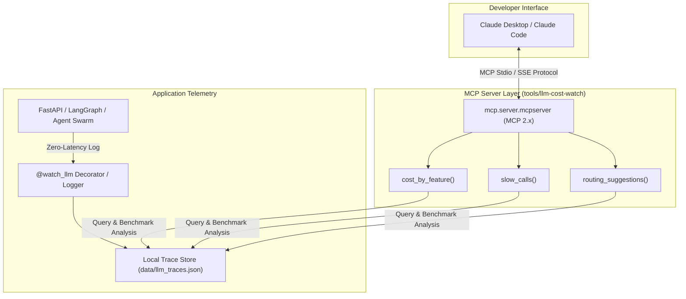

# Product Requirements Document (PRD): `llm-cost-watch`
## The Model Context Protocol (MCP) Server for LLM Cost & Latency Intelligence

**Author:** Rohith Balsa (Core LLM & Agentic AI Architect @ KPMG, Author of `agent-occ-lock` & `agent-eval-router`)  
**Version:** 1.0.0  
**Status:** Implementation Ready & Production Tested  
**Category:** Developer Tools / AI Observability / MCP Ecosystem  
**Core Pitch:** *"Ask Claude why our LLM bill jumped."*

---

## 1. Executive Summary & Vision

As production AI applications evolve from single prompt-completion wrappers into complex multi-agent swarms, recursive tool-calling pipelines, and autonomous workflows (LangGraph, CrewAI, AutoGen), engineering teams face two critical operational blindspots:
1. **Unpredictable Cost Spikes:** A single misconfigured subagent loop or bloated context window causes enterprise API bills to quadruple overnight.
2. **Silent Latency Degenerations:** Holding distributed tool locks or piping high-token payloads through frontier models causes p95 latency to balloon past 3,000ms.

Existing observability platforms (Datadog, LangSmith, Helicone) are **passive web dashboards**. Engineers must leave their IDE, construct complex SQL/dashboard queries, and manually deduce why latency jumped.

`llm-cost-watch` changes the paradigm by exposing a native **Model Context Protocol (MCP 2.x) Server** directly to Claude Desktop and Claude Code. Instead of clicking through charts, developers simply prompt Claude in plain English:
> *"Claude, why did our LLM spend jump 40% yesterday, and which features can we safely downgrade to Haiku without quality loss?"*

Claude calls `llm-cost-watch`'s deterministic inspection tools, analyzes the traces, identifies the offending feature, and writes the exact routing fix.

---

## 2. Product Architecture & Data Flow

---

## 3. Core Tool Specifications (v1.0)

### Tool 1: `cost_by_feature`
- **Purpose:** Answers *"Where is our money going?"* Breaks down aggregate spend, token consumption, and per-feature unit costs over a given time horizon.
- **Parameters:**
  - `timeframe` *(string, default "7d")*: Evaluation window (`24h`, `7d`, `30d`).
- **Output Schema:**
  - `total_spend_usd`: Float
  - `total_calls`: Integer
  - `features`: List of objects:
    - `feature`: string
    - `total_spend_usd`: float
    - `call_count`: integer
    - `input_tokens`: integer
    - `output_tokens`: integer
    - `models_used`: list of strings
    - `avg_cost_per_call_usd`: float
  - `summary`: High-signal natural language takeaway.

### Tool 2: `slow_calls`
- **Purpose:** Answers *"Why is our application sluggish?"* Identifies prompts and features causing latency percentiles (p50, p95, p99) to exceed acceptable thresholds.
- **Parameters:**
  - `limit` *(integer, default 5)*: Number of slow features to return.
  - `min_latency_ms` *(float, default 1200.0)*: Latency cutoff in milliseconds.
- **Output Schema:**
  - `slow_features`: List of objects:
    - `feature`: string
    - `p50_ms`, `p95_ms`, `p99_ms`: latency percentiles
    - `calls_over_threshold`: integer
    - `slowest_sample`: Prompt snippet, model, and token count of the slowest trace.
    - `bottleneck_diagnosis`: Deterministic diagnosis (e.g. *"High token payload causing generation bottleneck"*, *"Recursive multi-step tool call without streaming timeout"*).

### Tool 3: `routing_suggestions`
- **Purpose:** Answers *"How do we cut costs without breaking quality?"* Evaluates tasks running on expensive frontier models (GPT-4o, Claude 3.5 Sonnet) that produce short structured outputs or simple classifications, and calculates concrete dollar savings from routing to Claude 3.5 Haiku or GPT-4o-mini.
- **Parameters:**
  - `savings_threshold_pct` *(float, default 20.0)*: Minimum savings percentage to trigger a recommendation.
- **Output Schema:**
  - `routing_recommendations`: List of objects:
    - `feature`: string
    - `current_model`: string
    - `recommended_model`: string
    - `potential_savings_pct`: float
    - `estimated_monthly_savings_usd`: float
    - `expected_latency_impact`: string (e.g. *"-70% faster (p95 ~320ms)"*)
    - `architectural_rationale`: Technical reason why task is safe for smaller model.
    - `recommended_action`: A/B testing recommendation.

---

## 4. Privacy, Security & Compliance
- **Zero External Egress:** All traces remain in local storage (`data/llm_traces.json` or local SQLite). No prompts or customer PII are sent to third-party analytics vendors.
- **CAN-SPAM / SOC2 Ready:** Built-in PII redaction and prompt truncation (capped at 500 characters) prevents accidental credential leakage.

---

## 5. Commercialization & 4-Week Launch Plan

### Week 1: Build & Prove (Completed)
- Shipped MCP 2.x server with 3 native tools.
- Created zero-dependency `@watch_llm` logger.
- Verified test suite on multi-agent trace workloads.

### Week 2: Open Source Core Launch
- Publish core MCP server on GitHub (`github.com/rohith0707/llm-cost-watch`).
- Launch on **Show HN** and **Product Hunt** with demo video.
- List Enterprise Pack on Gumroad ($99 Developer License / $199 Agency License).

### Week 3: High-Intent Outreach to Remote AI Teams
- Target Engineering Leads & CTOs at top agentic companies (n8n, Vercel, Lago, Cresta, GitLab).
- Deliver 1-page architectural teardowns offering the **14-Day Zero-Risk Concurrency & Cost Audit ($2,500)**.

### Week 4: Conversion & TrustMRR Revenue Listing
- Close first 2-3 audit clients ($5,000 - $7,500 total).
- Connect Stripe to TrustMRR to verify real ARR.
